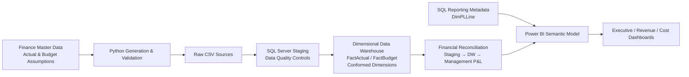
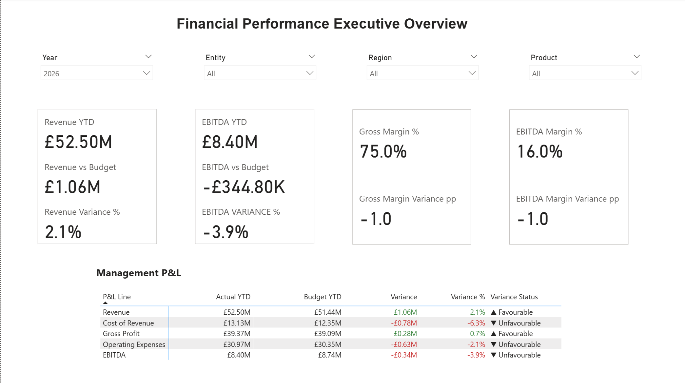
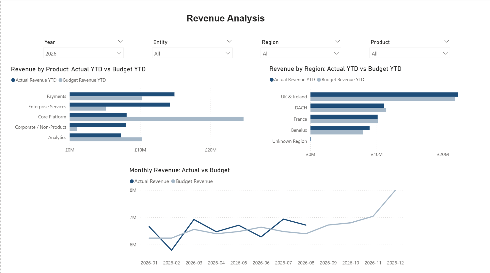
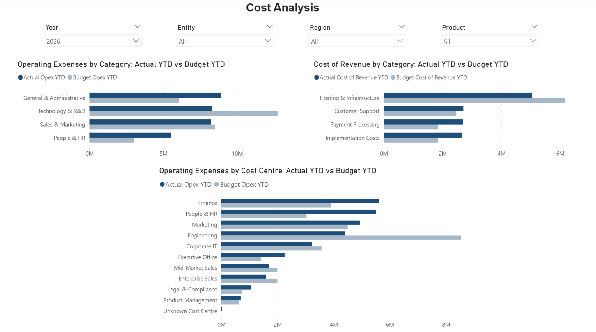

# Financial Performance & MI Reporting Solution

An end-to-end Finance Data and Management Information reporting solution designed to simulate a real-world Finance Systems / FP&A reporting environment.

The project integrates Actual, Budget and finance master data through Python, SQL Server and Power BI to deliver controlled, reconciled and interactive management reporting.

>**Note:** All company names and financial data in this project are synthetic and created for portfolio purposes.

---

## Business Scenario

Aurelia Technologies Ltd is a UK-based B2B SaaS company operating across the UK and Europe.

The Finance team relies on fragmented Excel-based processes for monthly reporting, making it difficult to:
 
 - compare Actual performance against Budget consistently;
 - analyse Revenue and Costs across products, regions and cost centres;
 - maintain consistent management P&L definitions;
 - identify source-data quality issues;
 - demonstrate reconciliation from source data to management reporting.

 This project builds a controlled reporting solution from source data generation through to executive Power BI dashboards.

 ---

## Solution Overview

The solution covers the full reporting lifecycle:

1. Generate synthetic Actual and Budget finance data in Python.
2. Validate master data and business rules before loading.
3. Load source data into SQL Server staging tables.
4. Run staging data-quality controls.
5. Transform data into a dimensional warehouse.
6. Reconcile staging, warehouse and management P&L values.
7. Build a Power BI semantic model using shared conformed dimensions.
8. Deliver Actual vs Budget, YTD and variance analysis through management dashboards.


## Architecture


---
## Data Model

The warehouse uses two fact tables at their natural grains:

- **FactActual** - transaction-level General Ledger activity
- **FactBudget** - monthly planning data

Both fact tables share the following conformed dimensions:

- Date
- Account
- Cost Centre
- Product
- Entity
- Region

Because Actual and Budget share the same conformed dimensions, the overall model forms a  **fact constellation (galaxy schema)**.

A separate SQL-driven **DimPLLine** controls the management P&L reporting structure, display order and favourable / unfavourable behaviour.

## Data Quality & Financial Controls

The solution implements controls across the staging, warehouse and reporting layers.

Examples include:

- duplicate transaction detection;
- missing and invalid business-key validation;
- entity / local-currency consistency checks;
- Budget business-grain validation;
- controlled Unknown dimension members for incomplete master data;
- foreign-key and dimensional integrity controls.

Financially valid transactions are preserved where possible rather than being dropped because of incomplete dimensional data.

### Reconciliation Framework

Three control layers are used:

1. **Raw / staging data quality**
2. **Staging to data warehouse reconciliation**
3. **Data warehouse to management P&L reconciliation**

The following key P&L measures are reconciled through the reporting pipeline:

- Revenue
- Cost of Revenue
- Gross Profit
- Operating Expenses
- EBITDA

---
## Power BI Reporting

The final Power BI report contains three management views.

### 1. Executive Overview
- Revenue YTD
- EBITDA YTD
- Gross Margin %
- EBITDA Margin %
- Actual vs Budget Management P&L
- favourable / unfavourable variance indicators
- Entity, Region and Product filtering


---
### 2. Revenue Analysis

Provides:

- monthly Actual vs Budget Revenue trend;
- Revenue by Product;
- Revenue by Region;
- YTD Actual vs Budget comparison using a common reporting cut-off.


---
### 3. Cost Analysis

Provides:

- Operating Expenses by category;
- Cost of Revenue by category;
- Operating Expenses by Cost Centre;
- visibility of controlled Unknown dimension members.


---
## Key Reporting Logic
### Common Reporting Cut-off

Actual data is available through **31 August 2026**, while the FY2026 Approved Budget covers the full financial year.

YTD measures therefore use the latest available Actual date as the reporting cut-off so that Actual and Budget are compared on a like-for-like basis.
### Favourable / Unfavourable Variance

Variance direction reflects the financial nature of the metric:
- **Revenue / Gross Profit / EBITDA** - higher is favourable
- **Cost of Revenue / Operating Expenses** - lower is favourable

The reporting layer standardises the output so that:
- positive variance = **Favourable**
- negative variance = **Unfavourable**

### Accessibility

Variance reporting does not rely on colour alone.
Directional symbols and explicit **Favourable / Unfavourable** labels are retained alongside conditional formatting.
---
## Key Design Decisions

### Separate Actual and Budget Facts

Actual and Budget are stored separately because they have different natural grains:

- Actual = transaction level
- Budget = monthly planning level

Combining them into one fact table would mix grains and reduce reporting integrity.

### Conformed Dimensions

Actual and Budget share the same dimensions, allowing consistent comparison across:
- Account
- Product
- Cost Centre
- Entity
- Region
- Date

### Controlled Unknown Members

Transactions with financially valid amounts but incomplete dimensional data are mapped to controlled Unknown members rather than being removed. This  preserves financial completeness while keeping data-quality exceptions visible.

### SQL vs Power BI Responsibility

Stable, reusable and governed logic is kept upstream in SQL where appropriate, while dynamic analytical calculations remain in Power BI.

Examples:

**SQL / Warehouse**
- dimensional structure;
- master-data mapping;
- data quality controls;
- reporting metadata;
- P&L reporting structure.

**Power BI**
- YTD calculations;
- Gross Profit and EBITDA;
- margin calculations;
- filter-context-dependent variance analysis;
- interactive management reporting.
---

## Technology Stack

|Area|Technology|
|---|---|
|Data generation|Python|
|Data Validation|Python / Pandas|
|Database|SQL Server|
|SQL development|SQL Server Management Studio|
|Data modelling|Dimensional modelling|
|Reporting|Power BI|
|Calculations|DAX|
|Version Control|Git / GitHub|

---
## Repository Structure
```text
financial-performance-mi-reporting/
│
├── data/
│   ├── raw/
│   └── processed/
│
├── data_generation/
│
├── documentation/
│   ├── business_requirements.md
│   └── data_model_design.md
│
├── powerbi/
│   └── financial_performance_mi_reporting.pbix
│
├── screenshots/
│   ├── 01_executive_overview.png
│   ├── 02_revenue_analysis.png
│   └── 03_cost_analysis.png
│
├── sql/
│   ├── 01_create_database_schema.sql
│   ├── 02_create_staging_tables.sql
│   ├── 03_load_staging_data.sql
│   ├── 04_staging_data_quality_checks.sql
│   ├── 05_load_master_data.sql
│   ├── 06_create_dw_dimensions.sql
│   ├── 07_create_load_fact_actual.sql
│   ├── 08_create_load_fact_budget.sql
│   ├── 09_finance_warehouse_qa.sql
│   └── 10_create_dim_pl_line.sql
│
├── requirements.txt
└── README.md
```
---

## Project Highlights

- Built an end-to-end Finance reporting pipeline from source generation to executive dashboards.
- Designed separate Actual and Budget fact tables using shared conformed dimensions.
- Implemented controlled data-quality exceptions and Unknown dimension handling.
- Built multi-stage financial reconciliation controls.
- Created SQL-driven management P&L reporting metadata.
- Developed YTD, margin and favourable / unfavourable variance logic in DAX.
- Delivered Executive, Revenue and Cost management reporting views in Power BI.
---

## Project Status
**Complete-portfolio-ready version**

The solution includes:

- synthetic finance data generation;
- master-data and business-rule validation;
- SQL Server staging and dimensional modelling;
- data-quality and reconciliation controls;
- Power BI semantic modelling;
- management P&L and Actual vs Budget reporting;
- Executive, Revenue and Cost analysis dashboards.

